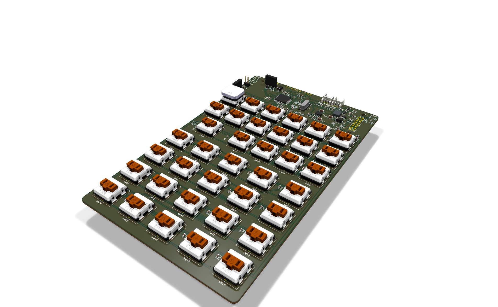
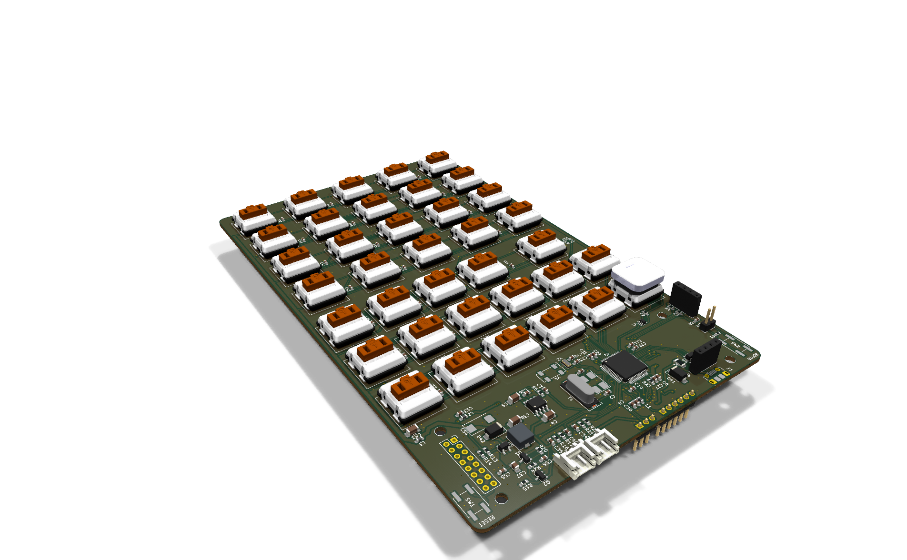
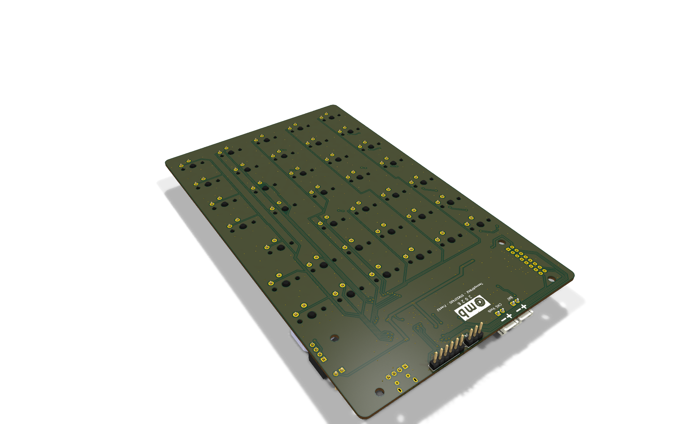
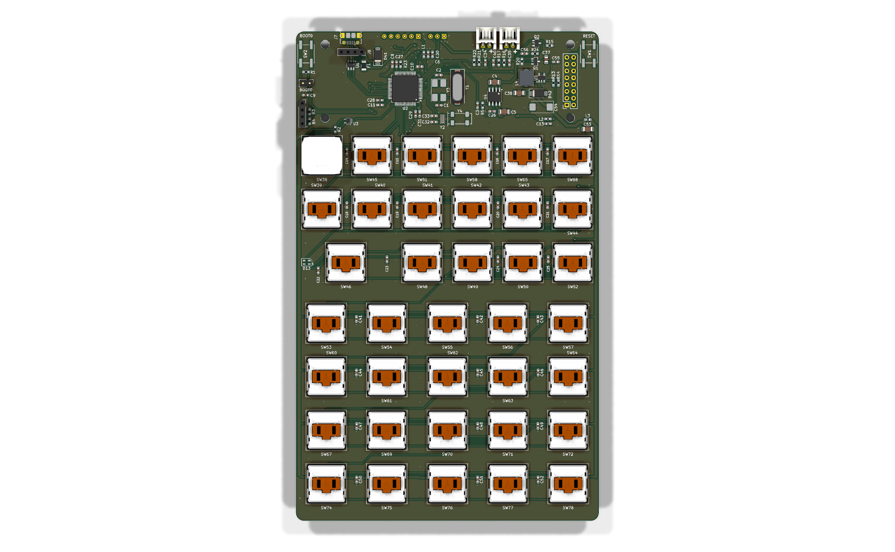
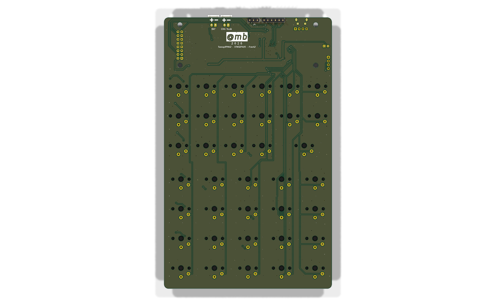

# TeensyRPN42 – PCB

Main board for an RPN calculator running [Free42](https://thomasokken.com/free42/) on an STM32F405.
37 Kailh Choc V1 keys, each with an SK6805 RGB LED in the key window, a 2.8" 256×64 SPI OLED, and a LiPo
supply with a switchable 5 V boost for the LEDs. Two layers; all parts on the top side except the SWD (J1) and serial (J4) headers.

| Front | Headers | Back |
|---|---|---|
|  |  |  |
|  | |  |

**Interactive BOM:** [bom/TeensyRPN42_ibom.html](bom/TeensyRPN42_ibom.html) (open in a browser; placement per part, with Reichelt numbers).

## Specs

| | |
|---|---|
| Board | 113.0 × 182.9 mm, 3 mm corner radius, 2 layers, 4 × M3 mounting holes |
| Fab | AISLER 2-layer simple (min. track 0.2 mm, clearance 0.15 mm, via 0.7/0.3 mm), vias tented |
| MCU | STM32F405RGT6 (LQFP64), 8 MHz HSE (Y1), 32.768 kHz LSE (Y2) for the RTC |
| Display | 2.8" OLED module, 16-pin header J3, SPI1 |
| Keys | 37 × Choc V1 (1u / 1.25u / 2u ENTER), 7 × 6 matrix, no diodes |
| LEDs | 38 × SK6805 (two under the 2u ENTER), one data chain, 5 V via 74AHCT125 level shifter |
| Power | 1-cell LiPo through an off-board TP4056 + DW01 module (J5 BAT, J9 CHG Vusb) |
| 3.3 V | MCP1727-3302 LDO from the battery (MCU, OLED) |
| 5 V | TS1935BCX5 boost (2.6–5.5 V in, 1.9 A switch), switched by PC3 through a P-FET load switch |
| USB | Micro-USB (J7), USB FS on PA11/PA12, USBLC6 ESD, 750 mA PTC, SMAJ5.0A TVS |
| Programming | USB DFU (BOOT0 button / jumper), SWD (J1) |

## Connectors

| Ref | Side | Pins |
|---|---|---|
| J1 SWD | back | 1 3V3 (VTref) · 2 SWCLK · 3 GND · 4 SWDIO · 5 NRST · 6 SWO |
| J4 Serial | back | GND · TX (PA2) · RX (PA3), 3.3 V, 115200 baud |
| J5 BAT | top edge | 1 GND · 2 PWR_SYS ← TP4056 module OUT+/OUT− (never B−) |
| J9 CHG Vusb | top edge | 1 GND · 2 VBUS → TP4056 module IN+/IN− |
| J10 BOOT0 | top | jumper = BOOT0 to 3.3 V → every reset lands in DFU |
| J2 / J8 | top | I²C1: PB8 SCL, PB9 SDA, 2.2 k pull-ups (mini OLED / spare) |
| J3 | top | 2.8" OLED module (SPI1) |
| J7 | top edge | Micro-USB (data + charging) |
| SW1 / SW2 | top (right / left edge) | RESET / BOOT0 |

## MCU pin map

| Function | Pins |
|---|---|
| Matrix rows 1…7 | PA9, PA10, PD2, PC12, PC11, PC10, PA15 |
| Matrix columns 0…5 | PC7, PC8, PC9, PB5, PB6, PB7 (inputs, pull-up) |
| OLED (SPI1) | PA5 SCK, PA7 MOSI, PA4 CS, PC4 D/C, RESET = NRST |
| LED data | PB10 → 74AHCT125 → 330 Ω → D1 … D38 |
| I²C1 | PB8 SCL, PB9 SDA |
| USART2 | PA2 TX, PA3 RX |
| USB FS | PA11 D−, PA12 D+ (VBUS sensing off, PA9 is ROW1) |
| SWD | PA13 SWDIO, PA14 SWCLK, PB3 SWO |
| VBUS_DET | PA1, 100 k / 150 k divider → ≈ 3.0 V with USB |
| BAT_SENSE | PA0, 1 M / 1 M divider → V_bat / 2 |
| BOOST_EN | PC3, high = 5 V on (100 k pull-down, off during reset) |
| BOOT0 / BOOT1 | BOOT0 10 k pull-down (SW2 / J10 → 3.3 V), PB2 10 k pull-down |
| Spare | PA8, PB0, PB1, PB4, PB11, PB12–PB15, PC0, PC1, PC2, PC5, PC6, PC13 |

## BOM

Reichelt article numbers where chosen; generic 0603 R/C parts are not listed by number.
22 µF / 10 µF ceramics: X5R/X7R, ≥ 10 V.

| Qty | Refs | Value | Package | Reichelt |
|---|---|---|---|---|
| 1 | U2 | STM32F405RGT6 | LQFP-64 | STM32F405RGT6 |
| 1 | U3 | 74AHCT1G125 | SOT-353 | 74AHCT1G125GW |
| 1 | U4 | MCP1727-3302E/SN | SOIC-8 | |
| 1 | U5 | TS1935BCX5 | SOT-23-5 | TS1935BCX5 |
| 1 | U6 | USBLC6-2SC6 | SOT-23-6 | |
| 1 | Q1 | IRLML6401 | SOT-23 | IRLML 6401 |
| 1 | Q2 | 2N7002 | SOT-23 | 2N7002 |
| 1 | L1 | ferrite 600 Ω @ 100 MHz, 0.5 A | 0603 | BLM18AG601SN1D |
| 2 | L2, L3 | ferrite 600 Ω @ 100 MHz, 1.3 A | 0603 | BLM18KG601SN1D |
| 1 | L4 | 10 µH, Isat ≥ 3 A | Bourns SRP5030T | |
| 1 | D42 | SS34 | SMA | |
| 1 | D41 | SMAJ5.0A | SMA | |
| 1 | F1 | PTC 750 mA hold | 1206 | |
| 38 | D1–D38 | SK6805 | PLCC4 2.4 × 2.7 mm | |
| 1 | Y1 | 8 MHz | HC49-SD | |
| 1 | Y2 | 32.768 kHz, CL 6 pF | 3215 | |
| 34 | C3, C6, C8–C11, C13–C25, C29, C40–C52, C55 | 100 nF | 0603 | |
| 2 | C1, C2 | 20 pF | 0603 | |
| 2 | C32, C33 | 6.8 pF | 0603 | |
| 1 | C26 | 1 nF | 0603 | |
| 1 | C56 | 47 nF | 0603 | |
| 1 | C30 | 1 µF | 0603 | |
| 2 | C27, C28 | 2.2 µF | 0603 | |
| 3 | C31, C34, C35 | 4.7 µF | 0603 | |
| 1 | C37 | 10 µF | 0805 | |
| 2 | C4, C5 | 10 µF | 1206 | |
| 2 | C38, C53 | 22 µF | 1206 | |
| 5 | R1, R5, R14, R23, R24 | 10 k | 0603 | |
| 1 | R2 | 330 | 0603 | |
| 2 | R3, R4 | 2.2 k | 0603 | |
| 1 | R13 | 30 k | 0603 | |
| 3 | R15, R20, R21 | 100 k | 0603 | |
| 1 | R22 | 150 k | 0603 | |
| 2 | R16, R17 | 1 M | 0603 | |
| 2 | SW1, SW2 | Panasonic EVQ-Q2 | SMD | |
| 37 | SW38–SW78 | Kailh Choc V1 (16 × 1u, 20 × 1.25u, 1 × 2u) | THT | |
| 1 | J1 | 1 × 6 pin header | 2.54 mm | |
| 1 | J4 | 1 × 3 pin header | 2.54 mm | |
| 1 | J10 | 1 × 2 pin header + jumper | 2.54 mm | |
| 2 | J2, J8 | 1 × 4 socket | 2.54 mm | |
| 2 | J5, J9 | JST-EH 2-pin, horizontal | S2B-EH | |
| 1 | J7 | Micro-USB B, Molex 105017-0001 | SMD | |
| 1 | J3 | 2.8" OLED module, 16-pin | – | |

**DNP (footprint only):** C54 220 µF polymer (optional +5 V bulk), Y3 (alternative 8 MHz footprint),
Y4 (alternative 32.768 kHz footprint).
**Off-board:** TP4056 + DW01 charger module (set R_PROG to 2.4 k ≈ 500 mA), 1-cell LiPo.

## Design notes

- **Power path:** battery → module OUT+ → J5 → PWR_SYS. PWR_SYS feeds the LDO (always on) and the boost
  through Q1. BOOST_EN (PC3) high → Q2 pulls Q1's gate low → BOOST_IN = battery → U5 starts → +5 V.
  R24 10 k + C56 47 nF slow Q1's turn-on to ≈ 0.45 ms (inrush into the 5 V / LED caps).
  Q1 is needed because a non-synchronous boost always conducts battery → L4 → D42 → +5 V; without it the
  LEDs would draw idle current in soft-off.
- **5 V budget:** ≈ 0.6 A at 5 V from a 3.0 V battery. Limit LED brightness in firmware (total LED current
  ≲ 0.5 A). Soft-off / low-battery warning at ≈ 3.4 V (BAT_SENSE); the DW01 only cuts at ≈ 2.5 V.
- **V-LED:** separate branch behind ferrite L3 with C53 22 µF at the feed point and 24 × 100 nF spread along the rows.
  Ladder layout: one trunk on each side, one bus per key row, so most rows are fed from both ends.
- **Filtering:** L1 + C6/C30 for VDDA, L2 + C13 for the OLED supply.
- **Key matrix (no diodes):** drive only the active row low, all other rows hi-Z; columns are inputs with
  pull-ups. One or two keys at a time are reliable; ghosting needs three or more held keys.
- **DFU:** hold BOOT0 (SW2), tap RESET (SW1), release. During development, a jumper on J10 keeps the board
  in DFU after every reset. `dfu-util -a 0 -s 0x08000000:leave -D firmware.bin`.
- **Clock:** use HSE 8 MHz → PLL 168 MHz (PLLM 8, PLLN 336, PLLP 2, PLLQ 7 = 48 MHz USB); HSI is not
  accurate enough for USB.
- **Fixed mechanics:** OLED J3, the 37 switches, H1–H4 and the outline are locked;
  `python3 check_fixed.py` verifies them against `fixed_placement.json`.
- **DRC:** clean. The LED-in-switch courtyard overlaps (intended) and H3/H4 vs J3 are excluded. Footprint
  library-mismatch warnings are local edits (silk tweaks) and intentional.
